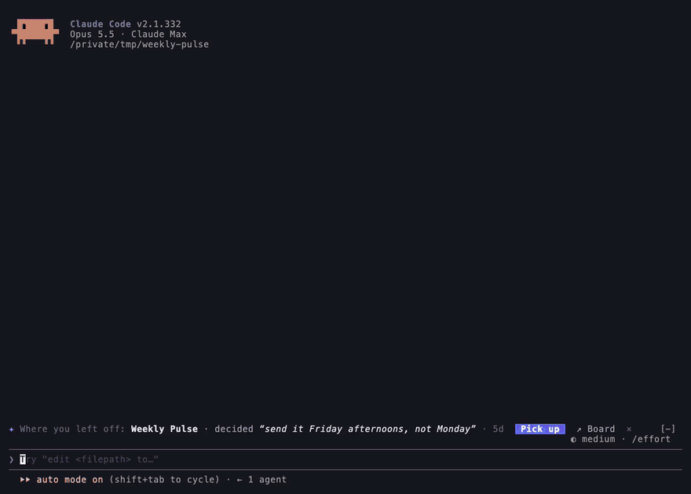

<p align="center">
  
</p>

<h1 align="center">Scintle</h1>

<p align="center"><b>Your AI chats, turned into a history of your ideas.</b></p>

<p align="center">
  <a href="https://github.com/scintle/scintle/releases/latest"></a>
  <a href="LICENSE"></a>
  <a href="https://scintle.github.io/scintle/"></a>
</p>

<p align="center">
  <a href="https://scintle.github.io/scintle/">Docs</a> ·
  <a href="https://scintle.github.io/scintle/start/install/">Install</a> ·
  <a href="https://scintle.github.io/scintle/trust/privacy/">What it reads and sends</a> ·
  <a href="https://github.com/scintle/scintle/issues/new/choose">Feedback</a>
</p>



## Why

If you build with Claude Code, your ideas live in your sessions. One gets sketched on a Tuesday, narrowed the
next week, renamed, parked for something more urgent, and picked up two months later by a version of you who
no longer remembers why it was parked. The reasoning is all there, scattered across dozens of chats that
Claude Code deletes after 30 days by default.

Scintle keeps that story for you. It reads your sessions in the background, finds the ideas in them and keeps
each one's history: where it started, what you decided, what you tried and dropped, and how it ended. You never
type an idea in.

## What you get

- **An idea canvas that fills itself.** New ideas, renames, pivots, pauses and releases show up as you work. Anything
  it isn't sure of is marked as a guess until you keep it, and one click fixes it when it's wrong.
- **Every idea's story.** Each idea keeps one ID through every rename and change of scope, with a timeline of
  what happened and the words that were said at each step.
- **Pick up where you left off.** Start Claude Code in a project and a line above the prompt tells you where
  that idea stands. Name an idea in a prompt and Claude reads its history before answering.
- **Plan with the history attached.** `/scintle:plan` hands an idea's story, its decisions and its dead ends to
  plan mode, and the plan you approve comes back to the idea's timeline.
- **Replay.** Watch months of ideas being born, branching, merging and ending, in seconds.
- **Local, no account.** One database on your disk and a board on `127.0.0.1`. Nothing goes to a Scintle
  server unless you turn on usage sharing.

## Install

You need Claude Code, Node.js 22.13 or newer, and macOS or Linux.

```sh
npx scintle install
```

That shows Claude Code's own install command and runs it after you say yes. Or run it yourself:

```sh
claude plugin install scintle --marketplace scintle/scintle
```

Then start a new Claude Code session and type `/scintle`. The board opens and asks before it reads anything,
with the number of sessions it found and how many model calls reading them will take.

| Command | What it does |
|---|---|
| `/scintle` | Opens the board |
| `/scintle:plan` | Pick an idea and plan it with its history (or `/scintle:plan I-007`) |
| `/scintle add`, `sync`, `stop`, `forget` | Read this folder's docs, read new sessions now, stop the server, delete everything |
| `/scintle companion on\|off`, `telemetry` | Turn the in-chat companion or usage sharing on or off |

## How it works

1. **Read.** A small local server (`scintled`) watches Claude Code's own folder, `~/.claude`: your sessions and
   saved plans. It reads other folders only if you add them, and nothing at all until you say yes.
2. **Extract.** It sends each session, with secrets removed first, to your own `claude -p`, which returns the
   ideas and what happened to them. These calls run with no tools, on your Claude plan, under a daily cap.
3. **Keep.** Ideas and their events go into one SQLite database in `~/.local/share/scintle`. An idea keeps its
   ID when it's renamed or narrowed. A pivot or a spin-off becomes a new idea linked to where it came from.
4. **Show.** The board in your browser, and a companion inside Claude Code that answers "what happened to that
   idea?" from the same database.

## Privacy

- **Reads** `~/.claude` and folders you add. Nothing else on your disk.
- **Stores** one local database. Secrets are redacted before anything is written.
- **Sends** session text, redacted, to your own `claude` command, only after you say yes. **Research**, only
  when you press it, lets `claude` search and read the web.
- **Bills** your Claude plan. If `ANTHROPIC_API_KEY` or a cloud provider is set where Claude Code starts,
  `claude` bills that instead, and Scintle tells you.
- **Usage sharing** is off unless you turn it on: one anonymous daily count, no ID, with a
  [published schema](https://scintle.github.io/scintle/trust/telemetry/).

The full list: [What it reads, stores and sends](https://scintle.github.io/scintle/trust/privacy/).

## Status

Scintle is in beta and reads Claude Code only. Codex and others are planned. See
[known gaps](https://scintle.github.io/scintle/trust/known-gaps/).

If it gets an idea wrong, that's the most useful thing you can tell me.
[Open an issue](https://github.com/scintle/scintle/issues/new/choose); on the board, **Help and feedback**
copies diagnostics that never include your ideas.

## Contributing

See [CONTRIBUTING.md](CONTRIBUTING.md). Licensed under [MIT](LICENSE).
