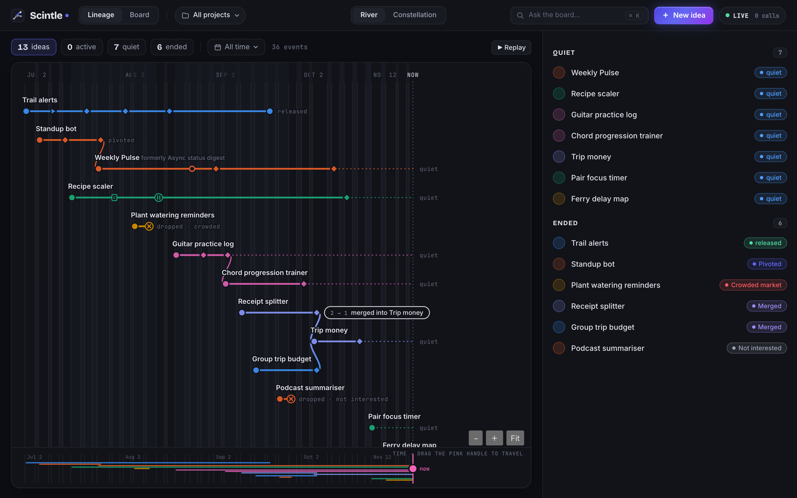

# Scintle

**Your AI chats, turned into a history of your ideas.**

Scintle keeps the story of every idea: how it started, how it changed, and where it ended up. It reads your
Claude Code sessions as you work and keeps each idea under a stable ID with its whole history: renamed,
narrowed, pivoted, parked, released, dropped. Nothing to maintain; you correct it when it's wrong.

**Docs: [scintle.github.io/scintle](https://scintle.github.io/scintle/)**



## Install

Needs Claude Code, Node.js 22.13 or newer, and macOS or Linux.

```sh
npx scintle install
```

It shows Claude Code's own install command (`claude plugin install scintle --marketplace scintle/scintle`) and
asks before running it. Then start a new Claude Code session and run `/scintle`.

| Command | What it does |
|---|---|
| `/scintle` | Opens the board. |
| `/scintle:sync` | Reads waiting sessions now. |
| `/scintle:plan I-007` | Plans an idea with its full history. |
| `/scintle:add` | Lets Scintle read the plans and docs in this folder. |
| `/scintle:telemetry` | Shows or changes the opt-in anonymous usage count. |
| `/scintle:forget` | Deletes everything Scintle stored. |
| `/scintle:stop` | Stops the background server. |

## What it reads, stores and sends

- **Reads** Claude's own folder, `~/.claude`, plus folders you add. Never anything else on your disk.
- **Stores** one local database in `~/.local/share/scintle`, with secrets redacted before anything is written.
- **Sends** session text, redacted, to your own `claude` command to read it, after you say yes; and an
  anonymous daily count with no ID, only if you turn it on.

Details: [What it reads, stores and sends](https://scintle.github.io/scintle/trust/privacy/) ·
[Telemetry](https://scintle.github.io/scintle/trust/telemetry/) ·
[Known gaps in the beta](https://scintle.github.io/scintle/trust/known-gaps/)

## Feedback

Scintle is in beta. [Open an issue](https://github.com/scintle/scintle/issues/new/choose); on the board,
**Help and feedback…** copies diagnostics that never include your ideas.

## Develop

See [CONTRIBUTING.md](CONTRIBUTING.md). MIT licensed.
