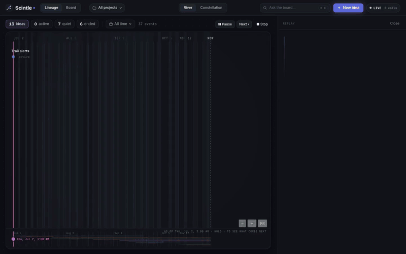

# Scintle

**Your AI chats, turned into a history of your ideas.**

You never type an idea in. Scintle finds every idea in your Claude Code sessions on its own, in the chats
you already had and the ones you're having now, and keeps each one under a stable ID with its whole history:
renamed, narrowed, pivoted, parked, released, dropped. You only correct it when it's wrong.

**Docs: [scintle.github.io/scintle](https://scintle.github.io/scintle/)**


## Install

Needs Claude Code, Node.js 22.13 or newer, and macOS or Linux.

```sh
npx scintle install
```

It shows Claude Code's own install command (`claude plugin install scintle --marketplace scintle/scintle`) and
asks before running it. Then start a new Claude Code session and run `/scintle`.

| Command | What it does |
|---|---|
| `/scintle` | Opens the board. |
| `/scintle:plan` | Pick an idea and plan it with its full history (or `/scintle:plan I-007`). |

`/scintle` also takes a word: `add` (read this folder's docs), `sync`, `stop`, `companion on|off`, `telemetry`, `forget`.

## The board

Every idea, with its history, on a board in your browser. Replay plays it back over time.



## What it reads, stores and sends

- **Reads** Claude's own folder, `~/.claude`, plus folders you add. Never anything else on your disk.
- **Stores** one local database in `~/.local/share/scintle`, with secrets redacted before anything is written.
- **Sends** session text, redacted, to your own `claude` command to read it, after you say yes; and an
  anonymous daily count with no ID, only if you turn it on.

Details: [What it reads, stores and sends](https://scintle.github.io/scintle/trust/privacy/) ·
[Telemetry](https://scintle.github.io/scintle/trust/telemetry/) ·
[Known gaps in the beta](https://scintle.github.io/scintle/trust/known-gaps/)

## Feedback

Scintle is in beta. [Open an issue](https://github.com/scintle/scintle/issues/new/choose); on the board,
**Help and feedback…** copies diagnostics that never include your ideas.

## Develop

See [CONTRIBUTING.md](CONTRIBUTING.md). MIT licensed.
